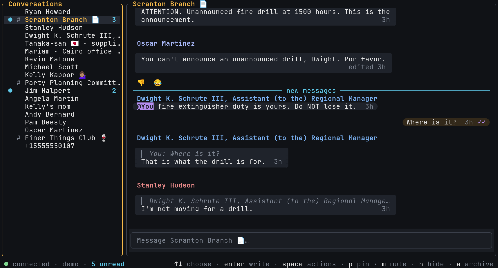

# faro

[](https://github.com/harababurel/faro/releases/latest)
[](https://github.com/harababurel/faro/actions/workflows/ci.yml)
[](https://aur.archlinux.org/packages/faro-bin)
[](LICENSE)

**Signal, in your terminal.** faro is an unofficial, open-source [Signal](https://signal.org) client for people who live in tmux and SSH. It's keyboard-driven, it looks good, and it never freezes.

Website and live demo (no install): **https://getfaro.dev**

<!-- TODO(owner): this image is generated from the app's own renderer (crates/faro-site's poster scene: the first frame of `faro demo`); replace it with a real screenshot or a GIF/WebM whenever you like. A light version is in docs/images/faro-light.png. -->



> faro is not affiliated with, endorsed by, or supported by Signal Messenger LLC or the Signal Technology Foundation.

## Why faro

- **Never freezes.** Network, decryption and storage run off the UI thread, so typing stays instant while messages flood in.
- **Everything is one keystroke away.** `Ctrl+P` opens one palette for chats, settings, themes, commands and search, and shows the key for each.
- **Made for SSH and tmux.** Copying works over SSH (OSC 52), the unread count shows in the tmux title, read receipts know whether you're looking, and emoji line up even through mosh.
- **The chat features you expect.** Replies, reactions, edits, deletes, forwards, mentions, search across all chats, delivery and read receipts, typing indicators, bell and desktop notifications.
- **Pictures and voice notes.** Inline images (kitty, sixel, iTerm2 or half-blocks), voice notes with waveforms and playback, and optional Whisper transcription (local, or remote only after you agree).
- **Looks the part.** Bubbles or IRC layout, 37 themes with live preview (plus your own), and a commented config file that reloads as you edit it.

## Install

```sh
brew install harababurel/tap/faro            # macOS / Linux (Homebrew)
yay -S faro-bin                              # Arch (AUR); also `faro` (from source) and `faro-git`
```

Debian / Ubuntu (`faro_arm64.deb` on ARM):

```sh
curl -LO https://github.com/harababurel/faro/releases/latest/download/faro_amd64.deb
sudo apt install ./faro_amd64.deb
```

Prebuilt archives for macOS (Apple silicon, Intel) and Linux (x86_64, ARM64), with checksums, are on the [releases page](https://github.com/harababurel/faro/releases/latest). To upgrade, use the same tool again (`brew upgrade`, your AUR helper, or the latest `.deb`).

<details>
<summary>Building from source</summary>

You need Rust via [rustup](https://rustup.rs); the exact toolchain is pinned in `rust-toolchain.toml` and rustup installs it on the first build. You also need the protobuf compiler and a C toolchain for libsignal and SQLCipher:

| OS | Packages |
|---|---|
| Arch | `sudo pacman -S protobuf cmake clang pkgconf openssl` |
| Debian/Ubuntu | `sudo apt install protobuf-compiler cmake clang pkg-config libssl-dev` |
| macOS | `brew install protobuf cmake` |

```sh
git clone https://github.com/harababurel/faro
cd faro
cargo build --release          # binary: target/release/faro
```

</details>

## Quick start

```sh
faro demo     # try it first: a fake account with scripted coworkers, nothing is sent
faro link     # link to your account: scan the QR code in Signal › Settings › Linked devices
faro          # run it
```

faro is a **linked device**, like Signal Desktop: your phone stays your primary device. Your messages and keys live in `~/.local/share/faro/`; the config file is `~/.config/faro/config.toml` (the same paths on macOS).

The demo is the new temp at a paper company's Scranton branch. It keeps its data in its own temporary directory and never touches your real data, but it shares your config file, so a theme you pick there stays picked. `faro demo --fresh` starts it over.

## Using faro

Press **`F1`** for every key, or search them in the palette. Every key can be rebound in the config file.

### Keys

| Key | What |
|---|---|
| `Ctrl+P` | Command palette: chats, settings, themes, commands, keys |
| `Alt+J` / `Alt+K` | Next / previous conversation (`Alt+1`…`Alt+9`: pinned ones) |
| `Tab` | Move between the conversation list, the messages and the input |
| `Enter` | Send (`Alt+Enter` or `Shift+Enter`: new line) |
| `↑` on an empty input | Select a message: `r` reply, `+` react, `e` edit, `y` copy, `Enter` for everything else |
| `Ctrl+F` | Search messages, in this chat or all of them |
| `Ctrl+V` | Paste an image from the clipboard (kitty) |
| `Alt+N` | Do not disturb: bell off / on |
| `Esc` | Back; then close the open chat |
| `Ctrl+Q` | Quit |

<details>
<summary>All default keys</summary>

**Everywhere**

| Key | What |
|---|---|
| `Ctrl+P` | Command palette. Inside it: `Enter`/`→` opens, `←`/`Backspace` goes back, `←`/`→` cycles a setting, `Ctrl+R` resets it; type `@` chats, `/` search, `:` settings, `>` commands, `?` keys |
| `Ctrl+F` | Search messages and voice-note transcripts |
| `F1` (or `?` outside the input) | All keys |
| `Alt+J` / `Alt+K` (or `Alt+↓` / `Alt+↑`) | Next / previous conversation |
| `Alt+1`…`Alt+9` | Pinned conversation 1–9 |
| `Tab` / `Shift+Tab` | Next / previous pane |
| `PgUp` / `PgDn` | Scroll the messages |
| `Alt+S` / `Alt+I` | Show or hide the conversation list / the info panel (shared links and files) |
| `Alt+N` | Do not disturb (the footer says `bell off`) |
| `Ctrl+V` / `Ctrl+O` | Paste an image from the clipboard / show the staged image |
| `Ctrl+L` | Redraw the screen |
| `Esc` | Back, dismiss; then close the open chat (nothing is marked read while no chat is open) |
| `Ctrl+Q` (or `Ctrl+C` twice) | Quit |

**Conversation list**

| Key | What |
|---|---|
| `j` / `k`, `g` / `G` | Move, first / last |
| `Enter` | Open the chat |
| `Space` | Conversation menu |
| `p`, `J` / `K` | Pin, move a pinned chat down / up |
| `m`, `@` | Mute (with a duration), notify for mentions only |
| `h`, `a`, `A` | Hide, archive, switch to the archive |
| `l`, `L` | Allow a chat, show only allowed chats |

**Messages** (after `↑` on an empty input, or `Tab`)

| Key | What |
|---|---|
| `j` / `k`, `g` / `G` | Older / newer, oldest / newest |
| `Enter` | Message menu |
| `r`, `f`, `+` | Reply, forward, react (`/` searches all emoji) |
| `e`, `D` | Edit, delete (your own messages) |
| `y`, `o`, `i` | Copy, open link, info and receipts |
| `d`, `v`, `s` | Download, view, save an attachment to `Downloads` |
| `x`, `t` | Play / stop, transcribe a voice note |
| `/`, `u` | Search, jump to unread |

**Input:** `@name` and `:shortcode:` complete inline; readline keys (`Ctrl+A`/`E`/`U`/`K`/`W`, `Alt+B`/`F`/`D`); `Ctrl+J` is a new line too.

</details>

### Configuration

On first run faro writes `~/.config/faro/config.toml` (or `$XDG_CONFIG_HOME/faro/config.toml`) with every setting commented out, showing its default and what it does. Edit it and faro applies the change while running (mistakes show in the footer); settings changed in the palette are written back without losing your comments. Your own themes go in `themes/` beside it, in [OpenCode's theme format](https://opencode.ai/docs/themes/).

| Flag | Environment | What |
|---|---|---|
| `--config FILE` | `FARO_CONFIG` | Config file |
| `--data-dir DIR` | `FARO_DATA_DIR` | Database, keys and logs |
| `--emoji auto\|full\|compatible` | `FARO_EMOJI` | How to draw emoji ([details](docs/TERMINALS.md#mosh-and-emoji)) |

`faro --help` and `faro demo --help` list the rest.

## Terminal setup

faro works in any modern terminal, and in tmux as it is. These tmux settings make it better (in `~/.tmux.conf`):

```tmux
set -g mouse on                        # clicks and the wheel reach faro
set -g set-clipboard on                # copying a message reaches your clipboard, even over SSH
set -g allow-passthrough on            # inline images (kitty, sixel, iTerm2)
set -as terminal-features ",*:RGB"     # truecolor themes
set -g extended-keys on                # more key combinations
set -g focus-events on                 # read receipts and the bell know whether you're looking
```

[docs/TERMINALS.md](docs/TERMINALS.md) covers the rest: inline images and why faro may fall back to half-blocks, mosh and emoji, colour depth, and bubble styles.

## Privacy and limits

- faro implements no cryptography of its own: it talks to Signal through [presage](https://github.com/whisperfish/presage), which builds on libsignal, Signal's own protocol library.
- Your data stays on your machine, in files readable only by you. It is **not encrypted at rest yet**.
- No telemetry: faro talks only to Signal's servers. The one exception is remote voice transcription, which is off by default and asks first. Logs never contain message text or phone numbers.
- Not yet: voice or video calls, stories, Windows, history from before linking. It can't be your only device: you need Signal on a phone.
- It's unofficial: a change on Signal's servers can break it until faro catches up.

To remove faro from your account, unlink it in Signal › Settings › Linked devices, then delete `~/.local/share/faro/`.

## Troubleshooting

- The log is `~/.local/share/faro/logs/faro.log`. Run `FARO_LOG=debug faro` for more detail.
- Borders out of line, images missing or the wrong colours: see [docs/TERMINALS.md](docs/TERMINALS.md). `Ctrl+L` redraws the screen.
- Found a bug? [Open an issue](https://github.com/harababurel/faro/issues) with `faro --version`, your terminal, whether you're in tmux, SSH or mosh, and the relevant log lines.

## Contributing

See [CONTRIBUTING.md](CONTRIBUTING.md) for building, the checks every change must pass, and where the design docs are.

## License

[AGPL-3.0](LICENSE). The bundled OpenCode themes are MIT-licensed; see [THIRD_PARTY_NOTICES.md](THIRD_PARTY_NOTICES.md).

`faro demo`'s cast is an affectionate parody of characters from NBC's *The Office*. faro is not affiliated with NBCUniversal or *The Office*.
