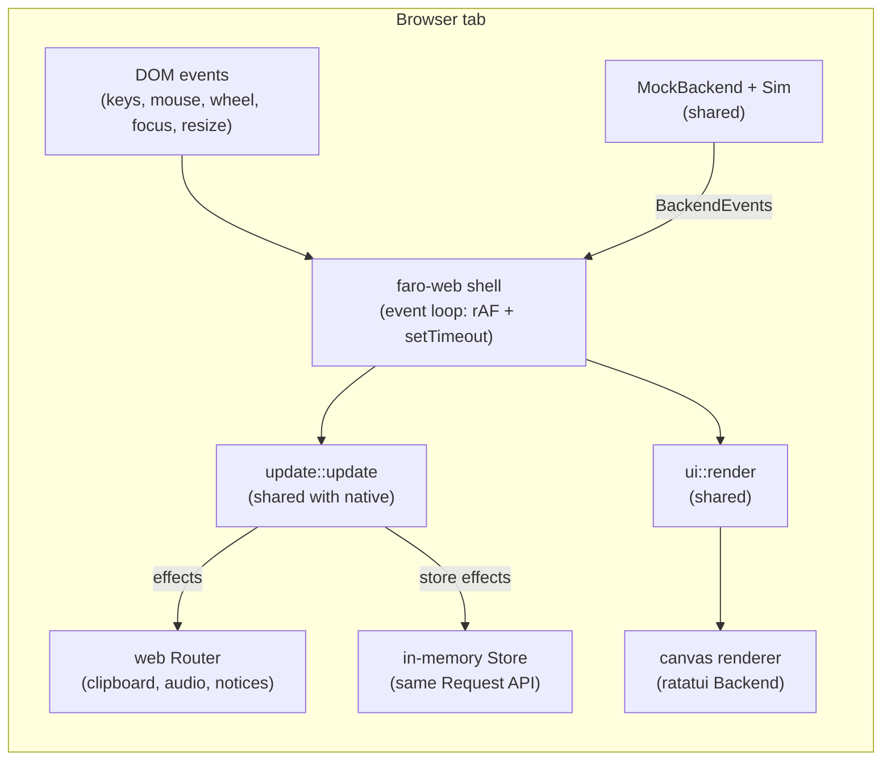
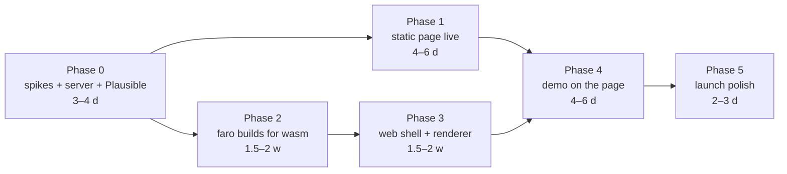

# getfaro.dev: landing page design and implementation plan

Status: **implementation in progress** (M13). Phases 0, 2 and 3 are complete;
Phase 1 code is complete and deployed; the owner's checks are deferred. Phase 4 is
integrating the demo into the page. Current progress is in PLAN.md and §7.
The decisions are summarised in §8.

---

## 1. Goals

1. **A stranger knows what faro is within five seconds**, without scrolling: a Signal client for the terminal, unofficial, open source.
2. **Visitors can use the real faro in the browser** (the highest priority). This is `faro demo` compiled to WebAssembly: the same reducer, renderer, themes and scripted cast as the native app, with no account, no install and nothing sent anywhere.
3. **Installing is never more than one screen away**, with copy-paste commands that are tested in CI.
4. **The page earns trust**: it says plainly how faro talks to Signal, where data lives, what is missing, and that the source is AGPL.
5. **The page is light and fast**, reads fine without JavaScript, works on phones (with an honest fallback for the demo) and has no cookies, no third-party scripts and no pop-ups. Visitor numbers come from a self-hosted, cookieless Plausible instance (§6.9).

### Non-goals (for v1)

- A documentation site. The landing page links to the README and docs in the repo; a docs site can come later.
- A blog, newsletter or account system.
- A touch-first demo. faro is a keyboard program; phones get a poster and an honest note (§4.7).

---

## 2. Audience and message

**Who it's for:** people who spend their day in a terminal, often over SSH and inside tmux, and who use Signal. They run kitty, Ghostty, WezTerm, iTerm2, foot or Alacritty on Linux or macOS. They value speed, keyboard control and config files, and they're suspicious of marketing gloss.

**Who it's not for:** people who want a phone-like messenger, calls or stories, or Windows support. The page says so rather than letting them find out after installing.

**The one-line message** (draft; easy to change later, §8):

> **Signal, in your terminal.**
> faro is an unofficial, open-source Signal client for people who live in tmux and SSH. It's keyboard-driven, it looks good, and it never freezes.

Every section after the hero backs up one part of that sentence.

---

## 3. Page structure

One page, top to bottom. The demo and the install command are both within the first two screens on a laptop.

```text
┌──────────────────────────────────────────────────────────────────────────┐
│ [lighthouse] faro            Install · Docs · Source · Changelog   ◐ │  nav (sticky only on desktop, thin)
├──────────────────────────────────────────────────────────────────────────┤
│                                                                          │
│   Signal, in your terminal.                                              │  hero: headline
│   An unofficial, open-source Signal client for people who live in       │  sub-line
│   tmux and SSH. Keyboard-driven, good-looking, never freezes.            │
│                                                                          │
│   [ ▶ Try it here, no install ]   $ brew install harababurel/tap/faro ⧉ │  two calls to action
│   Unofficial · not affiliated with Signal · AGPL-3.0 · v0.1.0            │  disclaimer + facts line
│                                                                          │
│ ┌──────────────────────────────────────────────────────────────────────┐ │
│ │                                                                      │ │
│ │          THE TERMINAL PANEL (poster → live faro demo)                │ │  full-bleed, ~120×34 cells
│ │                                                                      │ │
│ └──────────────────────────────────────────────────────────────────────┘ │
│  Ctrl+P palette · Alt+J/K chats · ↑ pick a message · + react · Enter send│  key hints
│  Theme: [faro-dark] [faro-dusk] [faro-light] [catppuccin] [nord] [gruvbox] … ⛶ ↺ │  theme chips, fullscreen, restart
│  Nothing you type leaves your browser.                                   │
├──────────────────────────────────────────────────────────────────────────┤
│  Why faro                                   (5 short items, 2 columns)   │
├──────────────────────────────────────────────────────────────────────────┤
│  Install                (tabs: Homebrew · Arch · Debian · Nix · Cargo · Binaries) │
│  then: faro link  → scan the QR code in Signal › Linked devices         │
├──────────────────────────────────────────────────────────────────────────┤
│  How it works & what to trust            (diagram + 5 plain statements)  │
├──────────────────────────────────────────────────────────────────────────┤
│  What it doesn't do (yet)                (honest list)                   │
├──────────────────────────────────────────────────────────────────────────┤
│  A few keys                              (10-row table, link to all)     │
├──────────────────────────────────────────────────────────────────────────┤
│  FAQ                                     (<details> items)               │
├──────────────────────────────────────────────────────────────────────────┤
│  footer: source · licence · changelog · disclaimers · contact            │
└──────────────────────────────────────────────────────────────────────────┘
```

### 3.1 Hero

- **Headline** and **sub-line** as in §2.
- **Primary action:** "▶ Try it here, no install". It scrolls to the panel (a few pixels below) and focuses the demo, which is usually already running by then (§4.2). Where the demo didn't preload, it starts it.
- **Secondary action:** the install command for the visitor's platform with a copy button. The default is Homebrew on macOS and the Linux command matching a coarse user-agent guess; the other methods are a click away in §3.4. Before binaries and packages exist, it shows `cargo install --git …` with the build prerequisites one click away.
- **Facts line:** "Unofficial · not affiliated with Signal · AGPL-3.0 · v0.1.0 (date)". The version and date are filled in at build time from the release tag. They show the project is alive without needing a social feed.

### 3.2 The terminal panel (the centrepiece)

The panel is wider than the text column, taking the full content width up to about 1200 px. Its frame is a plain border in the theme's `border` colour, with no fake window chrome or traffic lights. Its contents:

1. **Before JavaScript runs, or with JavaScript off:** a **poster**, a real frame of faro rendered at build time from the demo with a fixed seed (§6.4). It's an SVG with real text inside, so it is crisp at any zoom, selectable and readable by screen readers. It looks exactly like the first frame of the live demo.
2. **After the visitor clicks "Try it":** the WebAssembly demo loads (about 1 MB compressed, §6.6). It starts from the same seed and size as the poster, so the handover is seamless. The terminal stays where it was.

Below the panel are three thin rows:
- **Key hints**, kept short.
- **Theme chips** that switch the demo's theme live (35+ themes, so the visitor sees one of faro's best features in a second), plus **fullscreen** and **restart** buttons.
- **A one-line safety note.**

Details in §4.

### 3.3 Why faro

Five items, one idea each, every one true today and visible in the demo:

| Title | One line |
|---|---|
| **Never freezes** | Network, decryption and storage run off the UI thread, so typing stays instant while messages flood in. |
| **Everything is one keystroke away** | `Ctrl+P` opens one palette for chats, settings, themes, commands and search, and shows the key for each. |
| **Made for SSH and tmux** | Copy over SSH (OSC 52), unread count in the tmux title, read receipts that know whether you're looking, emoji that line up even through mosh. |
| **A chat list you control** | Pin, mute (with durations), hide, archive, or show only an allowlist. |
| **Looks the part** | Bubbles or IRC layout, 35+ themes with live preview, inline images (kitty, sixel, iTerm2 or half-blocks), voice notes with waveforms. |

There are no icons and no cards with drop shadows: a bold title and one line of text in a two-column grid, collapsing to one column on phones.

### 3.4 Install

- Tabs: **Homebrew · Arch (AUR) · Debian/Ubuntu (.deb) · Nix · Cargo · Binaries**. Only methods that work on launch day are shown. The rest appear when they ship (D86).
- Each tab has one command block with a copy button. A second block shows the next step:
  ```sh
  faro demo     # try it with fake contacts first
  faro link     # then link it: scan the QR code in Signal › Settings › Linked devices
  faro
  ```
- No platform line under the first-run commands (removed 2026-10-13, owner's call; the install methods already say which systems they cover).
- Under the Cargo tab, the build prerequisites table from the README (protobuf, cmake, clang…).
- **Every command on the page is tested in CI** (§6.8). A broken install line is the most damaging bug a landing page can have.

### 3.5 How it works, and what to trust

A small diagram, drawn as inline SVG in the page's own colours:

```text
 your phone (primary device)          Signal servers
          │  links                         ▲
          ▼                                │ end-to-end encrypted
 faro ── presage ── libsignal ─────────────┘
  │
  └─ ~/.local/share/faro  (history, keys: readable only by you)
```

Then five plain statements. Each must be checked against the code before launch:
- **It's a linked device, like Signal Desktop.** Your phone stays your primary device. faro links with a QR code (`faro link`).
- **faro doesn't implement any cryptography.** It talks to Signal through [presage](https://github.com/whisperfish/presage), which builds on libsignal, Signal's own protocol library.
- **Your data stays on your machine.** Keys and history are in `~/.local/share/faro`, readable only by you (`0600`). They are **not encrypted at rest yet**; that's planned.
- **No telemetry.** faro talks only to Signal's servers. The one exception is remote voice transcription, which is off by default and asks first. Logs never contain message text or phone numbers.
- **Open source, AGPL-3.0.** Read exactly what it does: source link.

### 3.6 What it doesn't do (yet)

This is an honest list, and it builds more trust than any feature list:
- No voice or video calls, no stories.
- It can't be your only device: you need Signal on a phone.
- No Windows.
- History from before linking isn't transferred yet.
- Data isn't encrypted at rest yet.
- It's unofficial: Signal doesn't support it, and a Signal server change can break it until faro catches up.

### 3.7 A few keys

A 10-row table (palette, switch chats, select, react, reply, search, mute, themes, help, quit), taken from `keymap/defaults.rs` at build time so it can't drift from the app. It links to the full list and says "every key can be rebound".

### 3.8 FAQ

Native `<details>` elements, so no JavaScript is needed. The answers are drafted in §5.3.

### 3.9 Footer

- Source (GitHub), licence (AGPL-3.0), changelog, releases and a contact link (GitHub issues).
- "faro is an independent project, not affiliated with, endorsed by, or supported by Signal Messenger LLC or the Signal Technology Foundation."
- "The demo's cast is an affectionate parody of characters from NBC's *The Office*; faro is not affiliated with NBCUniversal."
- "No cookies. Visitor numbers come from cookieless analytics on our own server ([Privacy](/privacy))." The footer also states the page weight.
- Links to **Privacy** and **Terms** (§3.10).
- The source link for the demo's WebAssembly build. AGPL needs this, and it's honest anyway.

### 3.10 Privacy and Terms pages

Two plain pages, `/privacy` and `/terms`, using the page's CSS, with no JavaScript and no analytics script on them. They are written for what this site actually does:
- no accounts;
- no email processor;
- a **self-hosted** Plausible instead of Plausible's cloud;
- a demo that runs entirely in the browser.

Drafts are in §5.5.

---

## 4. The live demo

### 4.1 What the visitor gets

The real `faro demo`:
- the Scranton cast and its scripted scenes;
- replies to whatever the visitor sends, from the existing reply pools;
- reactions, edits, deletes, mentions, typing indicators and receipts;
- half-block images and voice notes (played with Web Audio);
- the palette, settings and themes.

It runs entirely in the browser tab. Nothing is sent over the network after the files load.

### 4.2 Starting it

- **The demo preloads and starts by itself** (D-a), because many visitors would never click a button to start it:
  - After the page's first paint, once the browser is idle, the page fetches the demo files with low priority and starts faro in the panel. The poster becomes the live app, and messages start arriving. The visitor didn't have to do anything.
  - The live demo starts **unfocused**: it moves, but it captures no keys and no scrolling until the visitor clicks into it (§4.3). A small label in the panel's corner says *live · click to type*.
  - It doesn't preload on phones and small screens (§4.7), when the browser reports *Save-Data* or a 2G-class connection, or when JavaScript is off. In those cases the poster stays, with a "▶ Start the demo (1.1 MB)" button where it makes sense.
  - The demo files are fetched only after the page has loaded, so they don't count against the first-load budget (§6.6). They are cached, so repeat visits start at once.
  - The hero's "Try it" button scrolls to the panel and focuses it.
- While it loads, the panel keeps the poster and shows a progress line in the footer row (`loading faro · 640 KB / 1.1 MB`). It never shows a blank box.
- Settings for visitors (D-b): the default activity rate (one event per ~4 s), **no scripted outages**, a fixed seed (the same story every time), a fresh start on every visit. Settings changed inside the demo last for the visit only (D-c).

### 4.3 Focus and the keyboard

A web page must not trap the keyboard. The model:
- **Focused** after a click inside the panel or on "Try it". The border turns `border_active` (amber), and the footer row reads *keys go to faro · click outside or press Esc to leave*.
- **Leaving:** a click outside the panel, or `Esc` when faro has nothing left to close. That is the natural end of faro's own `Esc` chain (reply → notice → close chat). It needs one small signal from the reducer: "Esc did nothing".
- **Unfocused:** keys and the mouse wheel go to the page as usual. The panel still animates (messages arrive) but captures nothing.

**Browser-reserved keys.** Some chords never reach a page:
- In ordinary tabs: `Ctrl+W`, `Ctrl+T`, `Ctrl+N`, `Ctrl+Tab`.
- `Ctrl+Q` quits Firefox on Linux.
- On macOS, `Option+letter` produces characters.

The web build therefore:
- ships its own default keymap overrides through the existing `[keybindings.*]` mechanism (D43/D48), moving reserved chords to free ones;
- reads `Alt` chords from `KeyboardEvent.code`, not the produced character;
- turns quit (`Ctrl+Q`, `Ctrl+C` twice) into "restart the demo";
- uses `preventDefault` for the chords faro uses that browsers would otherwise act on (`Ctrl+P`, `Ctrl+F`, `Ctrl+L`, `Ctrl+K`, `Ctrl+O`, `Tab`, `Alt+←/→`…), but **only while focused**.

**Fullscreen** (⛶) gives the visitor the whole screen and, in Chromium, lets the page receive the reserved keys too (Keyboard Lock).

### 4.4 Size and type

- The grid is sized to the panel: about 120×34 cells on a laptop, never fewer than 90 columns. If the panel can't fit 90 columns at a readable size (13 px or larger), the visitor gets the mobile treatment (§4.7). The demo never shrinks text until it's unreadable, and never cuts it off.
- Cell metrics come from one bundled monospace webfont (§5.2). Block, octant, Powerline and quarter-circle glyphs (bubbles, logo, waveforms) are **drawn by the renderer itself**, so they're exact whatever the font (§6.3).
- Emoji use the system's colour emoji font, drawn at the width faro already decided, so alignment can't drift.

### 4.5 Theme chips, restart, fullscreen

- **Chips:** faro-dark, faro-dusk, faro-light, catppuccin, nord, gruvbox, tokyonight, and "all…" (opens the palette at Themes inside the demo). Clicking one switches the demo's theme live through the same code path as the palette. The demo starts in faro-dark or faro-light, matching the page's colour scheme.
- **Restart (↺):** a fresh demo with the same seed.
- **Quit inside faro:** a small overlay, "faro exited · ↺ start again".

Panel-control details (D126): chips and motion do not take the keyboard;
“all…” focuses the palette. Restart retains visitor theme/motion choices for
the visit, while resetting the mock/history/drafts and stopping old audio.
Fullscreen includes the caption controls, with optional Keyboard Lock excluding
Escape and released whenever the canvas stops holding the keys. The fixed grid's
font is re-measured after resize/fullscreen, never made smaller than 13 px.

### 4.6 Motion

- The page itself has no animation beyond hover states and a short focus transition.
- In the demo, motion is the app's own: arriving messages, typing indicators, the lighthouse on the logo screen.
- With `prefers-reduced-motion`, the demo starts with faro's `reduce_motion = true` (the lighthouse holds still). A "motion: off/on" toggle sits in the footer row, because the visitor may have set the system preference for other reasons.

### 4.7 Phones and small screens

The panel shows one readable pane at about 44 columns, not a whole scaled-down
screen. The conversation is the first of three swipeable static frames
(conversation, palette, themes), with no duplicate poster. Under it:
*faro is a keyboard app. Open this page on a computer to try the live demo.*
Slides stay at least 358 px wide (about 13 px text); smaller screens pan within
the gallery rather than shrinking the text. Labels and keyboard scrolling work
without JavaScript. Coarse-pointer devices and panels too narrow for the
120-column live grid receive the same treatment (D129).

A later option is a read-only "watch" mode, where the demo plays its scenes with no keyboard and taps switch chats. It's not in v1.

The three views are generated at 44×24 cells in dark and light from the real app
state/reducer/exporter (D128). The isolated SVGs outline bundled Latin font glyphs
as reusable paths and retain unsupported grapheme runs, such as emoji, as text
for system fonts (D129); they neither inherit page fonts nor fetch external ones.
Shrinking the live demo releases its session/audio; growing restarts it unfocused
with cached wasm and visitor choices. Initially small devices fetch no demo
manifest/wasm. Fullscreen is an explicit exception until the visitor exits it.

### 4.8 What doesn't work in the browser, and what happens instead

| Feature | In the web demo |
|---|---|
| Send a file, paste a path, paste an image (`Ctrl+V`) | Notice: "Not in the web demo: try it in your terminal" |
| Save to Downloads, open externally, copy file path | Notice (as above) |
| Copy a message (`y`) | Real: `navigator.clipboard` |
| Open a link (`o`) | Real: new tab, `noopener` |
| Voice notes (`x`) | Real: Web Audio (the demo's notes are synthesized WAV) |
| Transcription (`t`) | Canned transcripts for the demo's notes, marked `[demo]`; no network |
| Bell, title, desktop notifications | Panel border flashes; `document.title` shows the unread count; no OS notifications |
| Settings written to the config | Kept for the visit only (D-c); a reload starts fresh |

---

## 5. Visual design

### 5.1 Colour

The site uses faro's own built-in themes, so the page and the app look like they were made by the same hands:

| Role | Dark (default) from `faro-dark` | Light (`prefers-color-scheme: light`) from `faro-light` |
|---|---|---|
| Page background | `#101216` | `#f7f4ee` (warm paper) |
| Panels, code blocks | `#1a1d23` | `#efebe3` |
| Text | `#e6e6e6` | `#24272e` |
| Muted text | `#7c838f` (labels only, never body copy) | `#656a73` |
| Accent (one only) | `#f5b94a` lighthouse amber | `#9a5c06` deep amber |
| Borders | `#3a3f4a` | `#c9c3b6` |

- **One accent.** Amber is for the primary button, links, the focused panel border and the copy-button tick, nothing else.
- **Contrast:** body text at least 7:1 and everything else at least 4.5:1 (WCAG AA). Muted grey is never used for sentences.
- A small toggle (◐) in the nav overrides the system scheme. It's remembered in `localStorage` (preference only, no tracking).

### 5.2 Type

Two families at most:
- **Monospace** for the wordmark, headings, the terminal panel, commands and key names: **JetBrains Mono** (D107), self-hosted as three subset woff2 files (Regular, Bold, Italic; about 32 KB in total). The subset is ASCII, Latin-1, Latin Extended-A and the ~30 symbols faro uses. The renderer draws blocks, octants, box drawing, Powerline, Braille and the three symbols the font lacks (`↳ ✎ ❝`) itself.
- **System UI sans** (`system-ui, -apple-system, "Segoe UI", Roboto, …`) for prose. It costs zero bytes.
- **Sizes:** headline 40–56 px (fluid), prose 17–18 px with a line height of 1.6. Prose is capped at 70 characters per line. The terminal panel and tables can be wider.
- No web fonts from third-party hosts.

### 5.3 Copy

Rules:
- **Plain words.** Say what it is before saying why it's good. One idea per sentence. Specific nouns (tmux, SSH, OSC 52, kitty) rather than adjectives.
- **No unexplained acronyms** in the hero or "Why faro". Technical terms are fine further down, where the reader has opted in.
- **No comparatives without a reference** ("faster", "better"). Show it instead: the demo does the persuading.
- **A light touch of humour,** carried by the demo's cast, not the page's copy. (The "Dwight will reply" line under the demo was dropped on 2026-10-13, owner's call, with the poster note: the FAQ already says who the cast is and that the demo is real faro.)
- Honest about limits (§3.6). The page never implies Signal endorses faro.

Draft FAQ (to be checked against the code before launch):
- **Is this an official Signal app?** No. faro is an independent, open-source project. It isn't affiliated with or supported by Signal.
- **Do I still need my phone?** Yes. faro links to your account as a secondary device, like Signal Desktop. Your phone stays the primary device.
- **Is it safe?** faro doesn't do its own cryptography. It uses presage, which builds on libsignal, Signal's own library. Messages are end-to-end encrypted exactly as in other Signal clients. Your history and keys stay on your machine, readable only by you. They're not encrypted at rest yet. The code is AGPL: read it.
- **Can Signal block me for using it?** faro uses the same linked-device mechanism as Signal Desktop. It's unofficial, so Signal doesn't support it, and a change on their side can break it until faro is updated. *(Wording to be confirmed before launch.)*
- **Which terminals work?** Any modern one. Best in kitty, Ghostty, WezTerm, iTerm2, foot and Alacritty, inside tmux or not, over SSH or mosh. Rounded bubbles need a font or terminal with Unicode 16 block glyphs; otherwise faro draws bars.
- **Does it support calls / stories / Windows?** Not today (§3.6).
- **Can I change the keys and colours?** Yes. Every key can be rebound in `~/.config/faro/config.toml`. 35+ themes are built in, and you can drop in your own (OpenCode's theme format).
- **Who are the people in the demo?** Made-up coworkers at a paper company: an affectionate parody. They're fake, and nothing you type in the demo leaves your browser.
- **Is the demo really faro?** Yes. It's the same Rust code compiled to WebAssembly, with a fake backend instead of Signal.
- **Does this site track me?** No cookies and no third-party scripts. We count visits with Plausible, which runs on our own server, stores no personal data and uses no cookies. Details in the [privacy policy](/privacy).

### 5.4 Logo and imagery

- **The logo** is faro's own pixel lighthouse and 5×7 pixel wordmark from `ui/logo/art.rs`, exported to SVG by the build so it's identical to the app. Favicon: the small lighthouse.
- **The only imagery is real faro output:** the poster, the phone frames and the OG image, all generated from the app at build time (§6.4). No stock photos, illustrations, gradients or blobs.
- **Open Graph / social preview:** a 1200×630 PNG of the poster (conversation open, faro-dark) with the wordmark. It's regenerated with every release, so it never goes stale.

### 5.5 Privacy policy and terms (drafts)

These drafts cover what this site actually does: no accounts, self-hosted analytics, a demo that runs in the browser, and the software's own licence. Operator details (`{operator}`, `{contact}`, `{country}`, `{law}`) are placeholders, filled in from the site's configuration at build time.

- **Before publishing:** the operator checks every statement against the deployed setup (log retention, the Plausible configuration, the contact address).
- These are drafts, not legal advice.
- The pages carry a "Last updated" date and are kept in the repo, so changes are tracked.
- Statements about what the site does are checked by CI where possible. For example, a test fails if a page sets a cookie or loads a script from another origin.

#### Privacy Policy (draft)

> **Privacy Policy**. Last updated: *date*
>
> This policy explains how getfaro.dev processes personal data. It covers this website only. The faro application has no telemetry; see [How it works](/#trust).
>
> **Controller.** `{operator}` (`{contact}`), `{country}`.
>
> **Data we process.**
> - **Server logs:** IP address, date and time, requested URL, referrer and browser user agent, written by the web server for every request.
> - **Aggregate visit statistics:** see Analytics.
>
> We don't have accounts, forms or newsletters, and we collect nothing else.
>
> **The demo.** The demo on the home page runs entirely in your browser, with made-up contacts. Nothing you type in it is sent to us or anyone else, and it doesn't connect to Signal.
>
> **Purposes and legal basis.** We process server logs to operate and secure the site and to fix problems. We process visit statistics to understand how many people visit and which parts of the page they use. Both are based on our legitimate interests under the data protection law that applies to the operator (`{law}`) and, where applicable, Art. 6(1)(f) GDPR.
>
> **Cookies and local storage.** We use no cookies. Your browser's local storage keeps your light/dark choice and, if you opt out of analytics, that choice. Neither is sent to us.
>
> **Analytics.** We use Plausible Analytics (Community Edition), which we host ourselves on the same server as this site. No third party receives your data.
> - Plausible uses no cookies and stores no IP addresses or persistent identifiers.
> - To count unique visitors, it combines your IP address and user agent with a random value that changes every day and is then deleted, and it keeps only the resulting hash for that day.
> - Your IP address is used once to look up your country, and is not stored.
> - **To opt out**, use the "Don't count my visits" link on this page. It sets a flag in your browser's local storage.
>
> **Processors and transfers.** None. The site and its analytics run on privately operated infrastructure in `{country}`, and no data is transferred abroad.
>
> **Retention.** Server logs are kept for up to 30 days. Aggregate statistics contain no personal data and are kept for as long as they are useful.
>
> **Your rights.** Subject to applicable data protection law, you may request access to, correction or deletion of, restriction of, or object to the processing of your personal data. Contact `{contact}`. You may also complain to your competent data protection authority.
>
> **Security.** The site is served only over HTTPS. Access to the server and its logs is restricted.
>
> **Changes.** We may update this policy when the site or legal requirements change. The current version is published on this page.

#### Terms of Use (draft)

> **Terms of Use**. Last updated: *date*
>
> getfaro.dev is operated by `{operator}` (`{contact}`).
>
> **The site.** getfaro.dev provides information about faro, an unofficial, open-source terminal client for Signal, and an in-browser demo of it with made-up data.
>
> **The software.** faro is licensed under the GNU Affero General Public License v3.0. These terms don't change that licence. Your use of faro itself is governed by the AGPL, under which it is provided without warranty.
>
> **The demo.** The demo's characters and messages are fictional, an affectionate parody. The demo runs in your browser, sends nothing and connects to no Signal account.
>
> **Acceptable use.** Don't attempt unauthorised access to the site or its server, disrupt it, or use it to break the law.
>
> **Availability.** The site is provided without a guarantee of uninterrupted availability. Content and features may change or be discontinued.
>
> **Liability.** To the extent permitted by applicable law, the site is provided without warranties, and liability is limited to legally required cases.
>
> **Trademarks.** Signal is a trademark of Signal Technology Foundation. faro is not affiliated with, endorsed by, or supported by Signal Messenger LLC or the Signal Technology Foundation. *The Office* is owned by NBCUniversal; faro is not affiliated with NBCUniversal.
>
> **Governing law.** These terms are governed by `{law}`, subject to mandatory consumer protection rules that may apply in your country.
>
> **Changes.** We may update these terms. The current version is published on this page. The [Privacy Policy](/privacy) explains how data is processed.

---

## 6. Technical design

### 6.1 Site

- **Location:** a `site/` directory in the repo. It is plain HTML, CSS and a little vanilla JS (copy buttons, theme toggle, install tabs, demo loader): about 150 lines, with no framework and no bundler.
- **Generation:** a small Rust tool (`cargo xtask site`, or a `site` binary in the workspace) fills a template with:
  - the version, date and release links;
  - the key table from `keymap/defaults.rs`;
  - the theme list for the chips;
  - the poster SVG, phone frames and OG image (§6.4);
  - the logo SVGs;
  - content-hashed asset names.

  It outputs a static `dist/` folder.
- **Why not a static-site generator:** it's one page, the dynamic bits come from faro's own code, and a Rust tool can call that code directly. A docs site later can use mdBook or Zola beside it.

### 6.2 The demo in the browser (architecture)

The demo is compiled to `wasm32-unknown-unknown` and runs on the browser's own event loop. No server is involved, and no threads, so no special headers are needed.



What it reuses unchanged: `State`, the reducer, `ui::render`, themes, keymap, palette, input, timeline, `MockBackend`, `Sim`, the cast and scenes, `faro_core::config` parsing and editing.

What it replaces:

| Native piece | Web replacement |
|---|---|
| `main.rs`, `app.rs::run` (`tokio::select!` loop) | `faro-web` shell: DOM listeners → `AppEvent`; draws on `requestAnimationFrame` only when dirty; `setTimeout` for `next_deadline()` and for the logo animation only while it's visible (same rule as `app::logo_frame`) |
| crossterm events | Same event types on wasm (a small `term_event` module re-exports crossterm natively and defines matching types for the web) |
| tokio runtime and time | `wasm-bindgen-futures::spawn_local`, setTimeout-based sleep, `web-time` `Instant`; `tokio::sync` channels work as they are |
| sqlx/SQLite `Store` | `store/mem.rs`: serves the same `Request` enum from memory; the existing store tests run against both backends |
| `Router` effects (`open`, `osascript`, ffmpeg, curl…) | Web router (§4.8) |
| Config file and `notify` watcher | An embedded TOML (demo defaults plus web keybindings), parsed by the existing parser; edits go to the session or `localStorage` |
| ratatui-image | Half-block images from the `image` crate's decoders (identical to faro's half-block mode) |
| `tui.rs`, `tui/backend.rs`, tmux and mosh workarounds | Not used. A web emoji mode keeps only the "cut wide character" repair, not the tmux-specific rewrites |
| `logging.rs` file logs | Browser console in debug builds, nothing in release |

**As built (Phase 3, D113–D118):** the shell is `crates/faro-web`. It differs from the table above in these ways:
- **`term_event`:** faro's own types on both targets (D111).
- **Store effects and messaging commands:** run by shared code in faro-app (D113).
- **Images:** decoded and scaled by the browser (`createImageBitmap`), not the `image` crate (D117).
- **Settings:** last for the visit only; nothing goes to `localStorage` (D116).
- **Emoji:** the new `Exact` mode keeps a little more than the cut-wide repair (D118).
- **Logging:** none yet; no `tracing` subscriber is installed (D114).

### 6.3 Rendering

- faro already draws through ratatui's `Backend` trait, so the web needs a backend that paints cells onto a `<canvas>`.
- **Chosen (D106):** a small **custom Canvas 2D renderer** (about 1,000 lines):
  - it paints cell backgrounds, then text glyphs from the bundled monospace font;
  - **draws faro's block, octant, quarter-circle, Powerline and half-block glyphs as shapes** (the full set is already listed in `ui/bubbles/grid.rs`, `bubbles.rs` and `logo/art.rs`);
  - draws emoji at exactly the width faro's layout chose;
  - handles device pixel ratio for crisp output.
  - paints a wide glyph's background across every cell it covers: ratatui leaves the hidden cell with no background (D106).

  This gives the highest fidelity: rounded bubbles and the logo look exactly as in kitty.
- **Rejected (D106):** Ratzilla's WebGL2 backend (ratatui's official web crate). It can only draw glyphs its font atlas has: the Phase 0 prototype showed missing-glyph boxes on every bubble edge and Powerline cap, thin lines between half-block rows, and 1.1 MB gzipped before any faro code.
- **How the choice is made (D-d, agreed):** in Phase 0, build a throwaway prototype of each, about a day in total. Each draws the same real faro frame: bubbles with octant corners, the logo, ZWJ and flag emoji, a theme switch, and a flood of messages. Judge them on fidelity first (does it look exactly like faro in kitty?), then frame time and bundle size. **Keep one and delete the other;** both are never maintained. The custom renderer is expected to win on fidelity. **Done (D106):** Canvas 2D matched the frame cell for cell and was kept.
- Not recommended: xterm.js (its own width tables would bring back the misalignment bugs faro already fixed for tmux, and it adds a large JS dependency).

### 6.4 Poster, phone frames and OG image

- A headless generator runs the demo with a fixed seed and fixed clock (`MockConfig::deterministic`, pinned `View.now`, `logo_time: None`). It replays a short key script (for example, open Scranton Branch and scroll a little) and renders to a ratatui buffer.
- A **buffer → SVG exporter** (about 150 lines) writes the cells as `<rect>` backgrounds plus `<text>` runs, with block and octant glyphs drawn as paths. It shares the shape code with the canvas renderer.
- Output:
  - `poster-dark.svg` and `poster-light.svg`;
  - the cropped phone frames;
  - `og.png` (the SVG rasterised with `resvg` at build time).
- Because the live demo starts from the same seed, size and script, its first frame matches the poster.

### 6.5 Code changes in faro

These follow the existing rules: lints, no blocking calls, decisions recorded, quality gate.

1. **Make the shared code target-neutral:**
   - add `term_event` and `clock` modules;
   - move pure helpers out of native-only modules (`system::split_file_query`, `system::candidate_paste_path`, `system::Terminal`, `clipboard::ClipboardError`, `commands::Command`, `images::{ImageKey, box_size}`);
   - make `faro-presage`, sqlx, crossterm's event reader, ratatui-image, notify and the clipboard tty code native-only.
2. **Crate layout (D-e).** Either way, everything stays in this one repository and Cargo workspace. "Splitting" only means more folders under `crates/`, built and tested by the same `cargo test` and the same CI.
   - **Option A, split (recommended):** `crates/faro` becomes:
     - `faro-app`: a library with state, update, ui, theme, keymap, palette, input and timeline;
     - `faro`: the native binary, with tui, main, config files, system, commands, images, clipboard and player;
     - plus the new `faro-web`.

     That makes five crates in total: these three plus the existing `faro-core` and `faro-presage`. One-time cost: moving files with `git mv`, so history follows, and widening some `pub(crate)` items to `pub`. Ongoing benefit: an architecture test keeps terminal I/O, `tokio::process` and `notify` out of `faro-app`, so the web build can't break by accident. It is enforced by a tool, in the spirit of D27.
   - **Option B, no split:** `faro-web` is added, and native-only code inside `crates/faro` is fenced with `#[cfg(not(target_arch = "wasm32"))]`. It's smaller at first, but the fences spread through many files, and the only thing that catches a missing one is the wasm CI build.
   - Both options are about the same amount of work in Phase 2. A avoids long-term mess; B avoids a big one-time move.
3. **`faro-core`:**
   - a `sqlite` feature (default on) with `store/mem.rs` beside `store/db.rs`;
   - a small runtime shim for `MockBackend::drive` and the store task;
   - jiff with the browser time zone on wasm.
4. **`faro-web`:**
   - the shell, renderer, web router, Web Audio and the embedded demo config with web keybindings;
   - ~~a lint table of its own, because `wasm-bindgen` generates `unsafe` code~~: not needed. wasm-bindgen's glue doesn't trip `forbid(unsafe_code)`, so faro-web stays under the workspace lints (D114);
   - D28's no-panic and no-print rules still apply to faro-web's own code.
5. **CI:**
   - a `wasm32` build job;
   - a size budget check;
   - the store tests on both backends;
   - the site build;
   - the install-command checks (§6.8).

### 6.6 Performance budget

| What | Budget |
|---|---|
| HTML + CSS + JS (compressed) | ≤ 48 KB |
| Webfont (one subset woff2) | ≤ 60 KB |
| Poster SVG (compressed) | ≤ 80 KB |
| **First load total** | **≤ 200 KB**; first paint < 1 s on a slow 4G profile |
| Demo: wasm (after `wasm-opt -Oz`, compressed) + demo images | ≤ 1.5 MB, fetched **after** the page has loaded and only on capable desktops (§4.2); cached for a year (hashed names) |
| Demo frame time | < 4 ms per frame on a mid-range laptop; nothing is drawn while idle |

Ways to stay inside the budget:
- turn off jiff's bundled tz database on wasm;
- fetch demo images by URL instead of `include_bytes!`;
- optionally load the emoji table and themes after the first frame.

### 6.7 Accessibility

- Semantic HTML landmarks, a skip link, visible focus rings in amber, and full keyboard operation of the page.
- The canvas has `role="application"` and an `aria-label` explaining what it is and how to leave it. The poster SVG beside it carries the real text for screen readers. The demo is never the only way to learn anything on the page.
- The panel's focus can always be left (§4.3). Esc and clicking outside are announced in the footer row.
- Contrast as in §5.1. Pinch-zoom and browser zoom must keep working.
- `prefers-reduced-motion` and `prefers-color-scheme` are respected, with manual overrides.

### 6.8 Hosting, deployment and checks

- **Hosting (D-f):** a self-managed server with **nginx** in front. The site is static files that nginx serves directly, with no application server.
- **Deployment:** pull and build on the server. One script, `site/deploy/update.sh`, run by hand on the server:
  1. it runs `git pull --ff-only` in `/srv/getfaro.dev/repo`;
  2. builds the site into `/srv/getfaro.dev/releases/<commit>/`;
  3. switches the `current` symlink in one atomic step (`ln -sfn` + `mv -T`);
  4. keeps the last five releases.

  nginx serves `/srv/getfaro.dev/current`, so a visitor never sees a half-built site, rollback is one symlink change, and nginx needs no reload. There are no CI secrets and no deploy user. Automating it from CI can come later.
  - The site build must not need `protoc`/`cmake`/libsignal. `faro-web` and the site tool don't depend on `faro-presage` (§6.5), so the server needs only rustup (the toolchain pinned in `rust-toolchain.toml`, plus the `wasm32` target), `wasm-bindgen-cli` at the matching version, and `wasm-opt` from binaryen.
  - While the repo is private, the server clones it with a read-only GitHub deploy key.
- **nginx:** a server block with certbot-managed TLS. The full draft is in §6.10. In short:
  - **Hostnames and TLS:**
    - `getfaro.dev`, with `www.` redirected to it;
    - HTTP redirected to HTTPS, HSTS (`.dev` is HTTPS-only anyway).
  - **Compression and caching:**
    - precompressed `.gz` files from the build (`gzip_static`), with on-the-fly gzip as a fallback;
    - hashed assets cached forever; HTML `no-cache`.
  - **Security headers:** a strict CSP, `Referrer-Policy`, `nosniff`, `Permissions-Policy`.
  - **Logs:**
    - a separate access log for getfaro.dev, rotated daily and kept 30 days, matching the privacy policy. If it's ever kept longer, the policy changes in the same commit;
    - `/api/event` and the script path are proxied to Plausible on localhost (§6.9).
- **Bandwidth.** Preloading the demo (§4.2) means every desktop visitor downloads about 1.5 MB, so a burst of 10 new visitors a second needs about 120 Mbit/s of upload. Before a launch, check the server's uplink and anything else that shares it.
  - **Emergency switch:** the page reads `/demo/manifest.json` before preloading, and one nginx line can serve a version with `"preload": false` without a redeploy.
- **CI checks for the site:**
  - **Automated now (the CI `site` job):** `site/check.py <built dir>` over the `site/build.sh` output — link resolution (the nginx `try_files` rules), no third-party requests, no cookies, no inline code (the CSP's `'self'`), no leftover `{{…}}` placeholders and the §6.6 size budget. Chrome is required in CI for the no-JS render and real-wasm browser suite (D130). Node loader/harness unit checks run too. Still to do: Lighthouse, HTML validation and the install-command containers.
  - **Install commands:** each command is run in a fresh container per tab (Debian, Arch, Nix, macOS runner for Homebrew) on every release.
  - **Links:** a link checker.
  - **HTML:** validation.
  - **Size:** the budget from §6.6.
  - **Headless browser tests:**
    - the page renders without JS;
    - the demo starts, draws a frame and accepts a key;
    - Esc releases focus;
    - no console errors.
    - Desktop focus/send/restart/themes, mobile/no-fetch/scheme/gallery behavior,
      no-JS, Save-Data/preload-off/opt-out and responsive controls are checked by
      `CHROME=<chrome> node site/tools/browser_test.mjs <built dir> --out <reports>`.
      This uses Node 22 built-ins and a private server, with the real nginx headers
      and a tracker stub; it never sends telemetry. Assertions/errors/timeouts fail
      CI, with a report and up to eight screenshots retained on failure. Fullscreen
      denial is explicitly skipped after checking graceful recovery.
  - **Lighthouse thresholds:** performance, accessibility and best practices ≥ 95.
- Checks that need a person at a real browser go into `docs/MANUAL_TESTS.md` (rule 10): real Chrome, Firefox and Safari; macOS Option keys; a trackpad; a hi-DPI screen; a phone.

### 6.9 Analytics: self-hosted Plausible (D-g)

**Why self-host:** all visitor data stays on the operator's own server, nothing goes to a third party, and there is no limit on the number of sites, so other projects can share the instance.

**What runs** (Plausible Community Edition, current release v3.2.1, from the official `community-edition` Docker Compose setup):
- **Containers:** `plausible` (the app), `plausible_db` (PostgreSQL 16, for settings and users) and `plausible_events_db` (ClickHouse 24.12, for the event data). The setup ships ClickHouse's low-resource profile.
- **Requirements:** Docker with Compose, a CPU with SSE 4.2 (x86) or NEON (ARM), and **at least 2 GB of RAM** free for ClickHouse and Plausible.
- **Updates:** about twice a year. The image version is pinned in the compose file and upgraded deliberately.

**How it's wired:**
- **Its own hostname** for the dashboard, behind the same nginx (`<plausible-host>` below). It uses a neutral name rather than one under getfaro.dev, so other sites can share it. Plausible's HTTP port listens only on localhost; nginx terminates TLS.
- **Hardening:**
  - `DISABLE_REGISTRATION=true` after the operator's account is created;
  - TOTP turned on (`TOTP_VAULT_KEY`);
  - email is optional: without it there are no password-reset emails, or an SMTP relay can be added later.
- **Served from the site's own domain:** nginx on getfaro.dev proxies `/js/s.js` to Plausible's script and `/api/event` to its event endpoint, passing the visitor's IP in `X-Forwarded-For` so countries and unique visitors are counted correctly. This means:
  - the CSP stays `'self'`, with no third-party request at all;
  - the privacy policy can truthfully say no data goes to anyone else;
  - blockers that block Plausible's hostnames don't hide visits.
- **The script** (about 2 KB, `defer`) is on the home page only. It never runs inside the demo canvas and never sees what is typed there.

**What gets counted:** page views plus a handful of custom events, all without personal data:

| Event | Properties | Answers |
|---|---|---|
| `Demo started` | `how`: `auto` \| `button` | How many visitors actually see the live demo |
| `Demo focused` | — | How many visitors *use* the demo (the key number) |
| `Demo message sent` | — (once per visit) | How far they go |
| `Theme changed` | `theme` | Which themes interest people |
| `Install copied` | `method`: `brew` \| `aur` \| `deb` \| `nix` \| `cargo` \| `binary` | Which install methods matter |
| Outbound links | (Plausible's built-in outbound tracking) | Clicks to GitHub, docs, releases |

**Opting out:** a "Don't count my visits" link in the footer sets Plausible's `plausible_ignore` flag in local storage. Use it in your own browsers too.

Demo start, focus and message-send events count once per page load, including
across restarts (D127). Start means successful live handover, and send means an
accepted visitor send, not incoming activity. Theme events are committed changes,
not palette previews, automatic scheme changes or restart restoration. Tracking
is best-effort and cannot prevent the demo working. No typed content or message
metadata is ever passed to Plausible.

**Backups:** the statistics aren't critical. A weekly `pg_dump` of the settings database is enough. ClickHouse data can be rebuilt by starting over, losing only history.

### 6.10 Server runbook (draft)

> [!NOTE]
> **Superseded by the files in `site/deploy/`** (D109), which are the ones to use: [site/deploy/README.md](../site/deploy/README.md) is the runbook. They differ from this draft in two ways. Plausible CE 3.1+'s per-site script is proxied as `/js/s.js`, with its init in a same-origin `/js/init.js` (the snippet's inline script would break the CSP). The logs live in `/var/log/nginx/getfaro/` (Debian's nginx logrotate rule already matches `/var/log/nginx/*.log`). The dashboard host is `plausible.harababurel.com`.

These steps assume a Linux server with Docker, nginx and certbot, and a CPU that ClickHouse supports (§6.9). `<plausible-host>` is the analytics dashboard's hostname. Paths and ports are examples; check that the ports are free with `ss -ltn` first.

**1. DNS.**
- An A record for `getfaro.dev` (the apex can't be a CNAME), `www.getfaro.dev` as a CNAME to it, and a record for `<plausible-host>`.
- If the server's IP address is dynamic, keep the records updated with a dynamic-DNS client, and use TTLs of 5 minutes or less.

**2. Plausible CE** (in `/srv/plausible`, version pinned):
```sh
git clone -b v3.2.1 --single-branch https://github.com/plausible/community-edition /srv/plausible
cd /srv/plausible
cat > .env <<EOF
BASE_URL=https://<plausible-host>
SECRET_KEY_BASE=$(openssl rand -base64 48)
TOTP_VAULT_KEY=$(openssl rand -base64 32)
HTTP_PORT=8000
EOF
cat > compose.override.yml <<EOF
services:
  plausible:
    ports:
      - 127.0.0.1:8000:8000   # localhost only: Docker port rules bypass host firewalls otherwise
EOF
docker compose up -d
```
- Create the operator's account at `https://<plausible-host>` (after step 3), turn on TOTP, and store the recovery codes.
- Then add `DISABLE_REGISTRATION=true` to `.env` and run `docker compose up -d` again.
- With no email configured, a lost password can't be reset by email. Keep the credentials in a password manager.
- In the dashboard, add the site `getfaro.dev` and the custom events from §6.9 as goals.

**3. nginx: the Plausible dashboard.**
```nginx
server {
    server_name <plausible-host>;
    access_log /var/log/nginx/plausible.access.log;

    location / {
        proxy_pass         http://127.0.0.1:8000;
        proxy_http_version 1.1;
        proxy_set_header   Upgrade           $http_upgrade;   # live dashboard (websocket)
        proxy_set_header   Connection        "upgrade";
        proxy_set_header   Host              $host;
        proxy_set_header   X-Real-IP         $remote_addr;
        proxy_set_header   X-Forwarded-For   $proxy_add_x_forwarded_for;
        proxy_set_header   X-Forwarded-Proto $scheme;
    }
    listen 80;   # certbot --nginx -d <plausible-host> adds TLS and the redirect
}
```

**4. nginx: getfaro.dev.** The repo keeps this as a template (`site/deploy/nginx/getfaro.dev.conf`). Copy it into the server's nginx config rather than `include`-ing it from the repo, because certbot edits the file it finds. Then run `certbot --nginx -d getfaro.dev -d www.getfaro.dev`.
```nginx
server {
    server_name getfaro.dev;
    root  /srv/getfaro.dev/current;
    index index.html;

    access_log /var/log/nginx/getfaro.dev.access.log;
    error_log  /var/log/nginx/getfaro.dev.error.log;

    gzip_static on;                       # serve the build's precompressed .gz files
    gzip on;  gzip_vary on;
    gzip_types text/plain text/css application/json application/javascript image/svg+xml application/wasm;

    # Note: add_header in a location drops the server-level ones, so every location includes this.
    set $csp "default-src 'self'; script-src 'self' 'wasm-unsafe-eval'; connect-src 'self'; img-src 'self' data:; style-src 'self'; font-src 'self'; frame-ancestors 'none'; base-uri 'none'; form-action 'none'";

    location / {
        try_files $uri $uri.html $uri/ =404;      # /privacy → privacy.html
        add_header Cache-Control "no-cache";
        include /etc/nginx/snippets/getfaro-headers.conf;
    }

    location ~* "\.[0-9a-f]{8,}\.(js|css|woff2|wasm|svg|png|webp|jpg)$" {
        add_header Cache-Control "public, max-age=31536000, immutable";
        include /etc/nginx/snippets/getfaro-headers.conf;
    }

    # Emergency switch (§6.8): uncomment to stop preloading the demo, then `nginx -s reload`.
    # location = /demo/manifest.json { try_files /demo/manifest.no-preload.json =404; }

    # Plausible, same origin (§6.9). The script path is whatever the dashboard's snippet shows.
    location = /js/s.js {
        proxy_pass       http://127.0.0.1:8000/js/script.js;
        proxy_set_header Host <plausible-host>;
        add_header Cache-Control "public, max-age=86400";
    }
    location = /api/event {
        proxy_pass         http://127.0.0.1:8000/api/event;
        proxy_http_version 1.1;
        proxy_set_header   Host              <plausible-host>;
        proxy_set_header   X-Forwarded-For   $proxy_add_x_forwarded_for;
        proxy_set_header   X-Forwarded-Proto $scheme;
    }

    listen 80;   # certbot adds `listen 443 ssl` and the certificate lines
}

server {
    server_name www.getfaro.dev;
    return 301 https://getfaro.dev$request_uri;
    listen 80;   # certbot adds TLS
}
```
`/etc/nginx/snippets/getfaro-headers.conf`:
```nginx
add_header Content-Security-Policy $csp always;
add_header Strict-Transport-Security "max-age=63072000; includeSubDomains" always;
add_header Referrer-Policy "strict-origin-when-cross-origin" always;
add_header X-Content-Type-Options "nosniff" always;
add_header Permissions-Policy "camera=(), microphone=(), geolocation=(), payment=(), usb=()" always;
```
Check that `/etc/nginx/mime.types` maps `.wasm` to `application/wasm` (recent nginx does). Browsers refuse to stream-compile wasm served as anything else.

**5. Log retention.** `/etc/logrotate.d/getfaro`:
```text
/var/log/nginx/getfaro.dev.*.log {
    daily
    rotate 30
    missingok
    compress
    delaycompress
    notifempty
    sharedscripts
    postrotate
        [ -s /run/nginx.pid ] && kill -USR1 $(cat /run/nginx.pid)
    endscript
}
```

**6. First deploy and updates.**
- Once: clone the repo to `/srv/getfaro.dev/repo` with a read-only deploy key. Install rustup (the pinned toolchain and the `wasm32` target come from `rust-toolchain.toml`), `cargo install wasm-bindgen-cli --version <pinned>`, and `apt install binaryen`.
- Every update: `/srv/getfaro.dev/repo/site/deploy/update.sh` (§6.8).

---

## 7. Implementation plan

Each phase ends with something usable. Estimates assume one developer working sequentially.

### Phase 0: spikes and server setup (3–4 days)

- Install the `wasm32-unknown-unknown` target and trunk/wasm-bindgen. Build `faro-core`'s `MockBackend` and `Sim` for wasm behind a throwaway feature.
- Rendering prototypes (D-d): Ratzilla WebGL2 against a custom canvas, both drawing the same real faro frame. Keep one.
- Choose the webfont by checking glyph coverage and looks.
- **Server (the §6.10 runbook):**
  - DNS records for getfaro.dev and `<plausible-host>`;
  - the nginx server blocks, the headers snippet and logrotate rule, and certbot certificates;
  - the repo cloned with a read-only deploy key, the build toolchain, and `update.sh` deploying a placeholder page.
- **Plausible CE:** Docker Compose on the server, version pinned, registration closed after the operator's account, TOTP on, the getfaro.dev site added, the same-origin proxy (`/js/s.js`, `/api/event`) checked end to end.

**Done when:**
- a faro frame renders in a browser tab from wasm;
- `https://getfaro.dev` serves the placeholder page with valid TLS, and a visit shows up in the self-hosted dashboard;
- the renderer and font choices are recorded as D-entries.

### Phase 1: static landing page (4–6 days), shippable on its own

- The `site/` template, CSS (dark and light), install tabs, copy buttons and theme toggle.
- All copy from §3 and §5.3, checked against the code (trust statements, limitations, FAQ).
- `/privacy` and `/terms` from §5.5, checked against the deployed setup. Footer links and the analytics opt-out link.
- The Plausible script (same-origin) and the `Install copied` and outbound-link events.
- The site generator: version and date, key table, theme list, logo SVGs, hashed assets, precompressed `.br`/`.gz` files.
- The buffer → SVG exporter, plus a poster generator with a fixed seed and script. Generates the poster, phone frames and OG image.
- The CI site job: build, link check, size budget, no-JS check, a check that there are no cookies and no third-party requests. Plus deployment to the server.

**Done when:**
- the page is live on getfaro.dev with the poster where the demo will go;
- it works without JS and on a phone;
- the first load is ≤ 200 KB;
- Lighthouse scores are ≥ 95;
- visits and events appear in the dashboard;
- the install commands shown are the ones verified for the current state (source build until binaries exist).

### Phase 2: faro builds for the web (1.5–2 weeks)

- Target-neutral seams: `term_event`, `clock`, the runtime shim, pure helpers moved, native-only dependencies gated.
- The crate split (D-e), with an architecture test.
- `store/mem.rs`, with the store test suite parametrised over both backends.
- The CI wasm build job. The native quality gate stays green throughout (fmt, clippy pedantic, tests).

**Done when:**
- `cargo build -p faro-web --target wasm32-unknown-unknown` passes in CI;
- every store test passes on SQLite and in memory;
- native faro behaves exactly as before (snapshots unchanged).

**Done (2026-10-11):** as built in D110–D112. Differences from the plan above: no `clock` module (`faro_core::rt::Instant` covers it); faro-web is still a plain library under the workspace lints, so its own lint table comes with wasm-bindgen in Phase 3.

### Phase 3: the web shell and renderer (1.5–2 weeks)

- The event loop: DOM events → `AppEvent`, rAF drawing, deadlines, focus and visibility, and resize → grid size.
- The canvas renderer (or Ratzilla, per D-d), with glyphs drawn as shapes, emoji widths and DPR handling.
- The web router: clipboard, links, Web Audio voice notes, canned transcripts, notices for the unsupported features, title, bell flash.
- Embedded demo config with web keybindings, Alt read from `code`, quit → restart overlay.
- Web emoji mode and half-block images.

**Done when:** in a local test page:
- the full demo is usable with keyboard and mouse;
- the M4/M12 hands-on checklist items that make sense in a browser pass;
- frame time is < 4 ms;
- wasm is ≤ 1.5 MB compressed.

**Code done (2026-10-11), as built in D113–D119; closed by the owner's browser checks** (MANUAL_TESTS "Web demo", in Chrome, Firefox and Safari).
- **Size:** the wasm is 1.02 MB gzipped and about 746 KB with brotli. CI fails the build above 1.5 MB gzipped.
- **Frame time:** a whole frame from scratch averages 2.1 ms on an Apple M1 in headless Chrome. Under software rendering in headless Chrome on Debian, live frames are 2.7 ms at p50 and 8.3 ms at p95, so the < 4 ms target holds with a GPU but not at p95 without one (D119).

Differences from the list above:
- **Phase 4 items already in place:** the quit → restart overlay is on the test page (`crates/faro-web/www/index.html`). The bell flash is the page's job, via a `faro-bell` event.
- **Not done:** a console logger.
- **Deferred:** batching text runs in the painter (D119).
- **Not used in CI:** `wasm-opt -Oz`, which made the gzipped module slightly larger. `build.sh` still runs it when it's installed.

### Phase 4: the demo on the page (4–6 days)

- Preload and autostart (§4.2): idle-time fetch, the `manifest.json` preload switch, *Save-Data* and small-screen checks, a progress line, and the poster → live handover from the same seed.
- The focus model (§4.3), including the reducer's "Esc did nothing" signal and the *live · click to type* label.
- Key hints, theme chips, restart, fullscreen (with Keyboard Lock where available), the motion toggle.
- Demo analytics events (`Demo started`, `Demo focused`, `Demo message sent`, `Theme changed`), sent by the page's JS from signals the demo exposes. No message text is involved.
- Phone behaviour (§4.7).
- Headless browser tests in CI.
- `MANUAL_TESTS.md` entries for the browser matrix.

**Done when:**
- on a laptop, the demo is running in the panel a moment after the page loads, without a click;
- a visitor can click into it, chat with the cast, switch themes and leave with Esc or a click, in current Chrome, Firefox and Safari;
- the page stays usable without JS, on a phone and with preloading switched off.

**Progress (2026-10-13):** chunk 4.2 — preload, autostart and the handover — is done (D124): `site/template/demo.js` fetches the manifest when the page is idle, preloads only a capable device, shows a progress line over the poster's footer row, and swaps the poster for the canvas once faro has settled, on the poster's own 120×34 grid; the page's scheme, the hero CTA and the quit → restart overlay follow. Checked in headless Chromium; the owner's browser checks are in MANUAL_TESTS "Website: preload and handover". D124's resize gap is addressed by D126's font refit, keeping the grid fixed at 120×34.

**Chunk 4.3a done (2026-10-13, D125):** focus hints and the active panel border,
click-to-enter and click-outside/Esc-to-leave, with window and hidden-tab focus
handling. Escape releases the canvas only after faro's own dismissal chain;
startup chat opening and resizing never pretend the visitor typed. Headless
Chromium checks pass; the owner's Chrome/Firefox/Safari checks are in MANUAL_TESTS
"Website: focus and Escape".

**Chunk 4.3b done (2026-10-13, D126):** theme chips/All, motion, restart and
fullscreen with optional non-Escape Keyboard Lock; font refit and failed-load
retry. Native/browser checks pass, including the native keyboard API and dpr2.
Real-browser checks remain deferred in MANUAL_TESTS "Website: panel controls".
**Chunk 4.4 done (2026-10-13, D127):** the four demo analytics events in §6.9,
with page-level funnel deduplication and committed-theme tracking. Native send
predicate tests, 29 Node checks and real-wasm Chromium checks pass, including
opt-out, absent/throwing trackers, previews, restarts and payload privacy.
Site budgets and no-JS checks pass; dashboard/real-browser checks are deferred
in MANUAL_TESTS "Website: demo analytics". **Next: 4.5 phones**, then CI browser
tests (4.6).

**Chunk 4.5a done (2026-10-13, D128):** six deterministic phone frames generated
and written by faro-site; composition checked with local raster previews and
theme/selection correctness covered by tests. This is an asset-only checkpoint,
not completed mobile behaviour. **Next: 4.5b gallery and responsive wiring**, then
4.6 CI browser tests. Owner deployment remains deferred.

**Chunk 4.5b done (2026-10-13, D129), completing 4.5:** hashed, self-contained
stills in a no-JS swipe/keyboard gallery, responsive demo lifecycle and bounded
download/retry recovery. 700 native tests, 54 Node checks and Chromium checks
at 320/390/640/768 px, coarse-pointer 1200 px and live desktop 1440 px pass.
Scheme overrides, no-JS, isolated SVG fonts, keyboard/touch scrolling and
wide/narrow transitions were checked. Site budgets pass: 40,692/40,960 B page,
161,570/204,800 B conservative first load. Real-phone emoji and narrow fullscreen
checks remain deferred: headless has no emoji fonts and did not grant fullscreen.
**Next: 4.6 CI browser tests.** No deployment by agents.

**Chunk 4.6 done (2026-10-13, D130):** the site job requires Chrome and Node 22,
then runs loader regression checks, harness unit tests and real-wasm browser
coverage. Local runs pass 101 assertions across 22 scenarios in about 42 seconds;
700 native tests, 54 loader checks, five harness unit tests and site/no-JS budgets
pass. Negative validation/timeout runs fail with reports and clean up resources.
GitHub execution has since gone green (2026-10-13, after the repo went public).
Phase 4 code is complete; real-browser/device checks remain deferred.
Phase 5 follows, without deployment or publication by agents.

### Phase 5: launch polish (2–3 days)

**Status (2026-10-13, D131):** 404, `robots.txt`, `sitemap.xml`, canonical and Twitter tags, the source-commit footer link and the README link are done (security headers existed already). Left for the owner: running the `.deb` and build-from-source commands on a clean machine (Homebrew and AUR `faro-bin` installs worked, 2026-10-13), real screenshots in the README, then deployment. The legal details and FAQ answers were filled in on 2026-10-13.

- Final copy review. Run every command on the page on a clean machine.
- A 404 page, `robots.txt`, `sitemap.xml`, canonical URL, OG and Twitter card tags, the security headers.
- AGPL source link for the deployed build (commit hash in the footer).
- README updated to point at the site, with the site screenshots replacing the README's text capture.
- PLAN.md milestone and DECISIONS.md entries closed.

**Total:** about **4–6 weeks**, plus a few hours of server setup in Phase 0. Phase 1 can go live in the first week or so, before the demo is ready.



---

## 8. Decisions

Agreed on 2026-10-11 and recorded as D105 in DECISIONS.md. Phase 0's renderer and font choices get their own entries.

| # | Question | Decision |
|---|---|---|
| D-a | Start the demo on click, or preload? | **Preload and autostart** on capable desktops, unfocused until clicked; poster and a start button on phones and slow connections (§4.2) |
| D-b | Demo settings for visitors | Fixed seed, default activity (~4 s), no outages, fresh each visit |
| D-c | Remember settings changed in the demo? | No, for the visit only; the page's light/dark choice is remembered |
| D-d | Renderer | Throwaway prototypes of both in Phase 0, judged on fidelity first, then speed and size; keep one (§6.3). **Kept: custom Canvas 2D (D106)**; webfont: JetBrains Mono (D107) |
| D-e | Crate layout | One repo and workspace either way; split into `faro-app` + `faro` + `faro-web` (§6.5) |
| D-f | Hosting | A self-managed server behind nginx; static files, built on the server (§6.8, §6.10) |
| D-g | Analytics | Self-hosted Plausible Community Edition, served from getfaro.dev's own origin (§6.9); privacy policy and terms in §5.5 |
| D-h | Headline | "Signal, in your terminal." (easy to change later) |
| D-i | Launch timing | Phase 1 can go up with the source-build install; announce publicly once binaries and the demo are live |
| D-j | The demo's cast | Keep the parody (D88), with the footer disclaimer and the FAQ line |
| D-k | Remaining FAQ answers | Settled 2026-10-13 (owner): "Can Signal block me" and "Which terminals work" (tested: kitty, tmux, SSH, mosh; say "Best in …" again once the M8 matrix passes) |

**Operations:**
- Server logs for getfaro.dev are kept 30 days, the same figure as the privacy policy. They change together.
- Plausible runs without email for now. TOTP recovery codes and credentials are kept safe instead.
- The contact address in the legal pages comes from the site's configuration. A `@getfaro.dev` address would need mail set up for the domain first; today it rejects all mail.

---

## 9. Risks

| Risk | Mitigation |
|---|---|
| Emoji or glyph widths in the browser differ from faro's layout | Custom renderer draws block glyphs as shapes and emoji at faro's chosen width; poster and live frames compared in CI |
| Browser-reserved keys make some bindings unreachable | Web keymap overrides; fullscreen with Keyboard Lock; key hints show only the web bindings |
| The in-memory store drifts from SQLite | One test suite run against both backends |
| Two event loops to maintain (native and web) | The reducer, renderer and backend are shared; the shells stay thin; the architecture test keeps I/O out of `faro-app` |
| The wasm bundle grows | CI size budget; images by URL; optional lazy emoji table and themes |
| Install commands break | Run in CI on every release; only working methods are shown |
| The page oversells or goes stale | Version, date, key table, themes and screenshots are all generated from the code at build time; limitations listed openly |
| Third-party IP in the demo cast | Parody framing, footer disclaimer, cast kept swappable (D88) |
| AGPL obligations for the hosted build | Source link with the exact commit in the footer and on the demo panel |
| The demo preload saturates the server's uplink during a traffic spike | Small bundle; long caching; the `manifest.json` switch turns preloading off without a redeploy (§6.8) |
| The server's IP address changes and DNS lags | Dynamic-DNS client; short TTLs (≤ 5 min) |
| The server or its connection goes down | The site is static, so it's quick to bring back or to move: the same `dist/` folder works on any static host |
| Plausible CE needs upkeep (ClickHouse memory, upgrades) | Pinned version, low-resource ClickHouse profile, upgrades twice a year; stats aren't critical, so an outage loses only counts |
| The privacy policy drifts from what the server actually does | CI checks no cookies and no third-party requests; log retention set in the committed nginx/logrotate config; "Last updated" date on each change |
